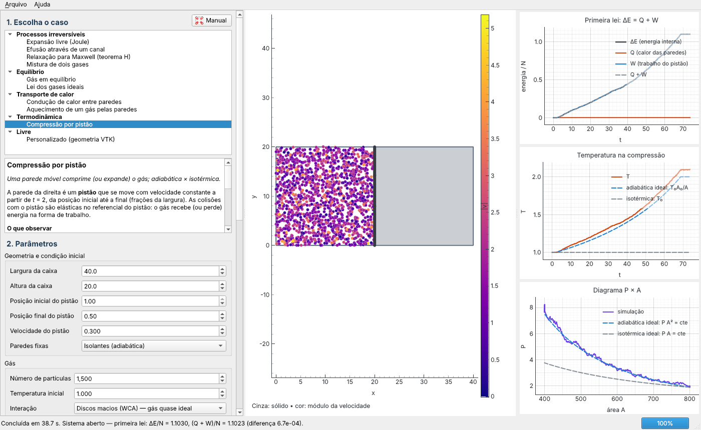
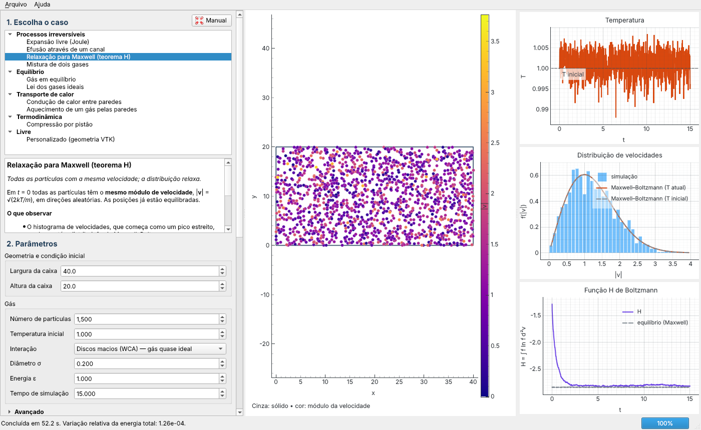

# TermoLab2D — termodinâmica partícula a partícula

Laboratório didático de termodinâmica e mecânica estatística: um gás bidimensional simulado
por dinâmica molecular (C++ / OpenMP), com uma interface em Python (PySide6 + pyqtgraph) que
mostra ao vivo temperatura, pressão, entropia, calor, trabalho e a distribuição de velocidades.
Feito para aulas: cada caso prepara um experimento clássico, explica o que observar e traz
atividades sugeridas no manual.



## Baixar e instalar

Os instaladores ficam na página **[Releases](../../releases/latest)**:

| Sistema | Arquivo | Como instalar |
|---|---|---|
| Windows 10/11 (64 bits) | `TermoLab2D-<versão>-instalador.exe` | Execute. Instala só para o usuário, sem administrador. Se aparecer “O Windows protegeu o computador”: *Mais informações → Executar assim mesmo*. |
| Debian 11+, Ubuntu 20.04+, Mint 20+ (64 bits) | `termolab2d_<versão>-1_amd64.deb` | `sudo apt install ./termolab2d_<versão>-1_amd64.deb` |

Os dois pacotes são autocontidos (levam o próprio Python e as bibliotecas). O manual em PDF
também está em Releases e dentro do programa (tecla **F1**).

## O que dá para fazer

| Grupo | Caso | Mostra |
|---|---|---|
| Processos irreversíveis | Expansão livre (Joule) | ΔS = Nk ln(1/f); a temperatura fica constante, cai ou sobe conforme a interação |
| | Efusão através de um canal | equilíbrio de pressão rápido, de temperatura lento |
| | Relaxação para Maxwell (teorema H) | velocidades iguais → Maxwell–Boltzmann; H decrescente |
| | Mistura de dois gases | entropia de mistura ln 2; paradoxo de Gibbs |
| Equilíbrio | Gás em equilíbrio | distribuição de Maxwell–Boltzmann, flutuações |
| | Lei dos gases ideais | pressão nas paredes, PA = NkT, fator de compressibilidade Z |
| Transporte de calor | Condução de calor entre paredes | perfil T(x), fluxo de calor estacionário |
| | Aquecimento de um gás pelas paredes | relaxação térmica, ΔE = Q |
| Termodinâmica | Compressão por pistão | adiabática × isotérmica, lenta × rápida, diagrama P × A, ΔE = Q + W |
| Livre | Personalizado | qualquer geometria VTK |

Interações entre partículas: discos macios (WCA), Lennard-Jones, Coulomb ou nenhuma.



## Documentação

* **Manual de uso** — [`gui/manual/manual.html`](gui/manual/manual.html) ou
  [`Manual_TermoLab2D.pdf`](Manual_TermoLab2D.pdf): instalação, a janela, parâmetros, cada caso
  com atividades para aula, o modelo físico, problemas comuns.
* **Documentação técnica** — o restante deste README: o simulador C++, o formato do `.cfg`,
  as interações, a interface e como gerar os instaladores.

## Para quem desenvolve

```bash
git clone <endereço deste repositório> TermoLab2D && cd TermoLab2D
python3 -m venv .venv --system-site-packages && .venv/bin/pip install -r requirements.txt
make && .venv/bin/python interface.py
```

Testes: `make test` (física em C++ e testes Python) e `python3 tests/smoke_app.py`, que abre
a interface e roda todos os casos. O GitHub Actions roda os testes a cada envio
(`.github/workflows/testes.yml`). Ao enviar uma tag de versão (`git tag v1.1 && git push origin
v1.1`), ele gera o instalador do Windows e o `.deb`, testa cada um instalado — o do Windows num
Windows de verdade — e os publica em Releases (`.github/workflows/instaladores.yml`). A versão
fica no arquivo `VERSION`.

## Licença

[MIT](LICENSE). Os pacotes incluem componentes de terceiros com licenças próprias: Python (PSF),
Qt/PySide6 (LGPL-3.0), numpy (BSD-3-Clause), pyqtgraph (MIT).

---

# Documentação técnica

## Executar a partir do código

```bash
cd "pasta/do/TermoLab2D"
python3 interface.py    # interface didática (casos, parâmetros, gráficos, manual)
python3 visualize.py    # visualizador simples de um arquivo .cfg
```

O programa compila automaticamente o C++ com OpenMP se necessário. O exemplo
contém 150 partículas em uma caixa de 20 × 16, com obstáculo retangular central.
A região cinza é sólida; as cores das partículas representam suas velocidades.
Use a barra de ferramentas do Matplotlib para ampliar e deslocar a imagem.
Fechar a janela encerra o simulador. Ao concluir, o último quadro permanece aberto.

Requisitos: `g++` com C++17/OpenMP, Python 3.10+, NumPy, Matplotlib e backend
gráfico Tk ou Qt. A interface didática (`interface.py`) usa também PySide6 e pyqtgraph. Em outro ambiente, as dependências Python podem ser instaladas
com `python3 -m pip install -r requirements.txt`. No Linux, Tk costuma ser fornecido
pelo pacote de sistema `python3-tk`.

```bash
# Compilar e testar
make
make test

# Usar outros parâmetros
python3 visualize.py examples/simulation.cfg

# Executar sem monitor, salvar imagem final e trajetória
python3 visualize.py --headless --snapshot resultado.png --record trajetoria.jsonl

# Executar apenas o C++
./build/simulator examples/simulation.cfg > trajetoria.jsonl
```

## Interface didática

```bash
python3 -m pip install -r requirements.txt   # PySide6 e pyqtgraph, uma única vez
python3 interface.py
```

O **manual de uso** completo está no menu **Ajuda → Manual de uso** (tecla F1 ou botão
**Manual**), com a seção do caso selecionado; cada descrição de caso tem um link para ele. O
manual fica em `gui/manual/manual.html` (abre também no navegador) e pode ser salvo em
PDF pelo botão “Salvar PDF…” da janela do manual.

A janela tem três etapas, na coluna da esquerda:

1. **Escolha o caso**. Cada caso traz um texto curto dizendo o que observar.

   | Grupo | Caso | Mostra |
   |---|---|---|
   | Processos irreversíveis | Expansão livre (Joule) | ΔS = Nk ln(1/f); T constante, cai ou sobe conforme a interação |
   | | Efusão através de um canal | equilíbrio de pressão rápido, de temperatura lento |
   | | Relaxação para Maxwell (teorema H) | velocidades iguais → Maxwell–Boltzmann; H decrescente |
   | | Mistura de dois gases | entropia de mistura ln 2; paradoxo de Gibbs |
   | Equilíbrio | Gás em equilíbrio | distribuição de Maxwell–Boltzmann, flutuações |
   | | Lei dos gases ideais | pressão nas paredes, PA = NkT, fator de compressibilidade Z |
   | Transporte de calor | Condução de calor entre paredes | perfil T(x), fluxo de calor estacionário |
   | | Aquecimento de um gás pelas paredes | relaxação térmica, ΔE = Q |
   | Termodinâmica | Compressão por pistão | adiabática × isotérmica, lenta × rápida, diagrama P × A, ΔE = Q + W |
   | Livre | Personalizado | qualquer geometria VTK |
2. **Parâmetros** — geometria e condição inicial do caso; número de partículas,
   temperatura inicial, interação (discos macios WCA, Lennard-Jones, Coulomb ou
   nenhuma, com σ, ε ou carga conforme o caso) e tempo de simulação. Em
   “Avançado”: tempo de equilibração, dt, quadros, cortes, massa, semente e threads.
3. **Visualizar** — escolha os gráficos mostrados ao lado das partículas:
   temperatura (total e em cada metade da caixa), energias, variação de entropia
   (configuracional, de velocidades e total), fração de partículas na metade direita,
   distribuição de velocidades com a curva de Maxwell–Boltzmann, perfis de densidade
   e de temperatura (instantâneos e médios), pressão e fator de compressibilidade,
   primeira lei (ΔE, Q, W), calor por parede, função H de Boltzmann, entropia de
   mistura, espécies do outro lado, temperatura na compressão e diagrama P × A.
   As partículas podem ser coloridas pela velocidade, pelo lado em que começaram
   ou pela espécie. Paredes térmicas aparecem em vermelho (quentes) ou azul (frias);
   o pistão, como uma barra escura com a região inacessível sombreada.

Os botões **Iniciar / Pausar / Parar** controlam a execução. A pausa é real:
o simulador C++ espera enquanto a interface não lê novos quadros. O menu
**Arquivo** salva imagens, exporta as séries temporais em CSV e grava o `.cfg`
do caso, com a geometria gerada, para uso com `visualize.py`. A seção “Gravação
de resultados” grava a trajetória (JSONL) e os quadros VTK para o ParaView.

Linhas tracejadas nos gráficos indicam valores teóricos, por exemplo
ΔS/Nk = ln(1/f) na expansão livre.

### Entropia

A entropia é a estimativa de Boltzmann em grade grossa, mostrada como variação
em relação a t = 0:

```text
S_conf/(N k) = −Σ p_i ln(p_i / A_i)          (posições, células de área livre A_i)
S_vel/(N k)  = −∫ f(v) ln f(v) d²v           (histograma 2D das velocidades)
```

Ambas usam a correção de Miller–Madow para o viés de amostras finitas. Para um
gás uniforme, S_conf → ln A; para Maxwell–Boltzmann 2D, S_vel = 1 + ln(2π kT/m).

### Como acrescentar um caso ou uma grandeza

* **Caso**: em `gui/scenarios.py`, crie um `Scenario` com os parâmetros
  próprios (`Param`), uma função `build(values, workdir)` que gera a geometria
  (funções em `gui/geometry.py`) e devolve as chaves do `.cfg`, e, se quiser,
  valores teóricos em `references`. Acrescente-o a `SCENARIOS`. O formulário
  é montado automaticamente.
* **Grandeza**: em `gui/observables.py`, crie uma subclasse de `Observable`
  (série temporal, distribuição ou perfil) e acrescente-a a `OBSERVABLES`.
  Se ela depender de um dado novo do C++, declare a chave em `requires`. A
  caixa fica desabilitada até o simulador emitir essa chave nos quadros, como
  acontece hoje com “Pressão nas paredes”.

### Pacote .deb para Linux (Debian, Ubuntu, Mint e derivados)

```bash
sudo apt install g++ zstd unzip dpkg-dev binutils python3-pil
python3 packaging/linux/build_deb.py
sudo apt install ./instalador/termolab2d_<versão>_amd64.deb     # instalar
```

O pacote é autocontido: um Python 3.12 do conda-forge, com PySide6 6.9 (a última série com
wheels para glibc 2.28), numpy, pyqtgraph e colorama, fica em `/opt/termolab2d`, junto com a
interface, o manual, os exemplos e o simulador compilado estaticamente. Ele cria o comando
`termolab2d`, a entrada no menu de aplicativos (com o manual em PDF como ação) e os ícones. As
dependências do sistema (X11/xcb, OpenGL, fontes) são calculadas automaticamente a partir das
bibliotecas usadas pelo Qt. Requisitos: amd64, glibc 2.28+ (Debian 11+, Ubuntu 20.04+, Mint 20+).
O campo Maintainer pode ser definido com a variável `TERMOLAB2D_MAINTAINER="Nome <email>"`.

### Instalador para Windows

O instalador (`instalador/TermoLab2D-<versão>-instalador.exe`) é gerado no Linux, sem precisar de
uma máquina Windows:

```bash
sudo apt install g++-mingw-w64-x86-64-posix nsis zstd unzip
python3 packaging/windows/build_windows.py
```

O script compila `simulator.exe` com MinGW-w64 (OpenMP estático, sem DLLs extras), monta um
Python 3.12 para Windows a partir dos pacotes do conda-forge, acrescenta as wheels de PySide6
(só os módulos Qt usados), numpy, pyqtgraph e colorama, copia a interface, o manual e os
exemplos, e gera com o NSIS um instalador de 64 bits que instala por usuário (sem
administrador) em `%LOCALAPPDATA%\Programs\TermoLab2D`, com atalhos no menu Iniciar e na área
de trabalho e desinstalador. Versões fixas no script tornam o build reprodutível; os downloads
ficam em `packaging/windows/_cache`. O ícone é gerado por `packaging/make_icon.py`.

Requisitos do usuário: Windows 10 (1903+) ou 11, 64 bits. Erros na interface instalada são
mostrados numa janela e gravados em `%LOCALAPPDATA%\TermoLab2D\erro.log`.

### Linux e Windows

A interface procura o simulador nesta ordem: variável `TERMOLAB2D_SIMULATOR` (o nome antigo `MD2D_SIMULATOR` também vale),
`build/simulator` (ou `build/simulator.exe`), compilação automática com `g++`
quando as fontes são mais novas, e `bin/<linux|windows>/`. No Windows sem
compilador, basta colocar um `simulator.exe` pré-compilado (MinGW-w64, com
`-static -fopenmp`) em `bin/windows/`.

## Exemplo de expansão do gás

```bash
python3 visualize.py examples/expansion.cfg
```

Este exemplo usa `examples/expansion_box.vtk`: caixa retangular livre de
40 × 20, sem obstáculo ou divisória central. As 1.500 partículas são sorteadas
uniformemente apenas na metade esquerda, `0 <= x < 20`, em toda a altura.
As velocidades iniciais seguem a mesma distribuição térmica 2D, sem impulso
artificial para a direita. Durante a simulação, toda a caixa é acessível.
Isso representa a liberação do gás para a metade inicialmente vazia a partir
de t = 0; a seleção inicial não cria uma parede persistente.

O arquivo usa:

```ini
geometry = expansion_box.vtk
initial_x_min = 0.0
initial_x_max = 0.5
```

Os limites são **frações da largura total** medida a partir da origem da caixa,
não coordenadas absolutas. Devem satisfazer
`0 <= initial_x_min < initial_x_max <= 1`. Alguns exemplos:

| Região inicialmente ocupada | `initial_x_min` | `initial_x_max` |
|---|---:|---:|
| Metade esquerda | 0 | 0.5 |
| Metade direita | 0.5 | 1 |
| Quarto à esquerda | 0 | 0.25 |
| Caixa inteira (padrão) | 0 | 1 |

O sorteio considera apenas a área livre dentro dessa faixa. Cortes que atravessam
células recebem peso proporcional à área acessível, mantendo densidade inicial
uniforme. Faixas sem área livre ou com limites inválidos são rejeitadas.
Sem esses parâmetros, o comportamento anterior permanece: toda a área livre é
usada na inicialização. A geometria não é modificada pela condição inicial.

O exemplo mantém a repulsão coulombiana (`charge = 1`), de modo que a expansão
converte energia potencial em energia cinética e a temperatura pode variar.
Para observar a expansão de partículas livres, coloque `charge = 0`: nesse caso
não haverá interação nem colisões entre partículas, somente reflexões nas paredes.
A temperatura de entrada continua definindo apenas a condição inicial.

São 20.000 passos de dt = 0.001 (tempo físico final 20), com um quadro a cada
40 passos. A cadência de 30 quadros/s leva cerca de 17 segundos se o cálculo
acompanhar essa taxa. Para salvar a trajetória completa emitida e a imagem final:

```bash
python3 visualize.py examples/expansion.cfg --record expansao.jsonl --snapshot expansao.png
```

As imagens `examples/expansion_initial.png` e `examples/expansion_final.png`
mostram os estados inicial e final de uma execução verificada do exemplo.

## Configuração

Edite `examples/simulation.cfg`. Formato `chave = valor`; comentários começam
com `#`. O caminho da geometria é relativo ao arquivo de configuração.

| Parâmetro | Exemplo | Significado |
|---|---:|---|
| `geometry` | `geometry.vtk` | Máscara VTK 2D |
| `particles` | 150 | Número de partículas |
| `initial_x_min` | 0.0 | Início da faixa inicial, como fração da largura da caixa |
| `initial_x_max` | 1.0 | Fim da faixa inicial, como fração da largura da caixa |
| `temperature` | 1.0 | Temperatura inicial |
| `mass` | 1.0 | Massa de cada partícula |
| `charge` | 1.0 | Carga de cada partícula, igual para todas |
| `boltzmann` | 1.0 | Constante de Boltzmann |
| `coulomb_constant` | 1.0 | Constante eletrostática |
| `cutoff` | 3.0 | Raio de interação |
| `softening` | 0.05 | Regularização na origem; 0 dá Coulomb exato |
| `dt` | 0.001 | Passo de tempo |
| `steps` | 5000 | Quantidade de passos; 0 emite só a condição inicial |
| `output_every` | 10 | Passos entre quadros emitidos |
| `threads` | 4 | Threads OpenMP; 0 usa a configuração do ambiente |
| `seed` | 42 | Semente aleatória |
| `potential` | coulomb | Interação: `coulomb`, `wca`, `lj` ou `none` |
| `sigma` | 0.2 | Diâmetro σ (WCA e Lennard-Jones) |
| `epsilon` | 1.0 | Energia ε (WCA e Lennard-Jones) |
| `lj_cutoff` | 2.5 | Corte do Lennard-Jones, em unidades de σ |
| `min_distance` | 0 | Distância mínima entre partículas na condição inicial |
| `equilibration_steps` | 0 | Passos de equilibração antes de t = 0 |
| `particles_b` | 0 | Partículas da espécie B (as de `particles` são da espécie A) |
| `mass_b`, `sigma_b` | = A | Massa e diâmetro da espécie B |
| `initial_b_x_min`, `initial_b_x_max` | 0, 1 | Faixa inicial da espécie B (frações da largura) |
| `velocity_distribution` | maxwell | `maxwell` ou `mono` (mesmo \|v\| para todas, direções aleatórias) |
| `wall_temperature_left` (`_right`, `_bottom`, `_top`) | — | Parede térmica a essa temperatura; omitida = especular |
| `piston_x0`, `piston_x1` | 1, 1 | Posição inicial e final do pistão (frações da largura) |
| `piston_speed` | 0 | Velocidade do pistão; 0 = sem pistão |
| `piston_start` | 0 | Instante em que o pistão começa a se mover |

Apenas `geometry` é obrigatória. O padrão de `softening` no código é 0; o exemplo
escolhe explicitamente 0.05. Os outros valores padrão coincidem com a tabela.

O exemplo usa **unidades reduzidas**, com m = q = kB = kC = 1. Temperatura 1
não significa 1 kelvin. Para usar SI, massa, carga, distâncias, tempos e constantes
devem ser todos expressos em unidades compatíveis.

## Interações e condição inicial

`potential` escolhe a interação entre pares. O padrão no `.cfg` continua `coulomb`,
para manter compatíveis os arquivos antigos. A interface usa `wca` por padrão.

```text
coulomb: U = kC q² [1/sqrt(r²+s²) − 1/sqrt(rc²+s²)],  r < cutoff         (repulsão, longo alcance)
wca:     U = 4ε[(σ/r)¹² − (σ/r)⁶] + ε,                  r < 2^(1/6) σ      (só repulsão: discos macios)
lj:      U = 4ε[(σ/r)¹² − (σ/r)⁶] − U_LJ(rc),           r < lj_cutoff·σ    (repulsão + atração)
none:    U = 0
```

Na expansão livre a energia interna se conserva, e o sinal de (∂T/∂V)_U depende da
interação. Com σ = 0,2, ε = 1, 1.500 partículas e T₀ = 1, na metade esquerda da
caixa 40 × 20 (de t = 0 a t = 20):

| Interação | T em t = 20 | Interpretação |
|---|---:|---|
| `none` | 1,00 | gás ideal |
| `wca` | ≈ 1,01 | quase ideal (repulsão de curto alcance) |
| `lj` | ≈ 0,92 | a atração faz o gás esfriar |
| `coulomb` | ≈ 6,7 | a repulsão acumulada vira energia cinética |

`min_distance > 0` sorteia as posições sem pares mais próximos que essa distância,
por adsorção sequencial aleatória. Se a densidade for alta demais para isso, usa
uma rede quadrada com espaçamento de pelo menos `min_distance` e uma pequena
perturbação aleatória. A interface usa `min_distance = 2^(1/6) σ` com WCA e LJ.

`equilibration_steps > 0` faz a dinâmica correr antes de t = 0 com paredes
temporárias nos limites da faixa inicial (`initial_x_min` e `initial_x_max`) e com
as velocidades reescaladas para a temperatura alvo a cada passo. Assim o gás
começa em equilíbrio, sem o transiente do sorteio das posições. Depois de t = 0
não há termostato. A interface usa 5 unidades de tempo de equilibração; o valor
é ajustável em “Avançado”.

## Paredes térmicas, pistão, espécies e pressão

**Paredes térmicas** (`wall_temperature_*`) são difusivas: a partícula que as atinge
volta com componente normal sorteada da distribuição do fluxo,
`v_n ∝ v_n exp(−m v_n²/2kT_p)`, e tangencial gaussiana, ambas à temperatura da
parede. A energia trocada em cada parede é acumulada e emitida como `wall_heat`.
O sorteio usa um gerador determinístico por (semente, partícula, passo, evento): o
resultado não depende do número de threads.

**Pistão**: parede vertical que vai de `piston_x0` a `piston_x1` com velocidade
constante a partir de `piston_start`; o gás fica à esquerda. A colisão é elástica
no referencial do pistão, `v_x' = 2u − v_x`; a energia transferida é acumulada
como trabalho (`piston.work`). Em pistões rápidos, a interface reduz `dt`
automaticamente.

**Duas espécies**: `particles` (A) e `particles_b` (B), com massas e diâmetros
próprios; com WCA/LJ, σ_AB = (σ_A + σ_B)/2. Na equilibração cada espécie fica
na sua faixa inicial.

**Pressão**: a cada quadro, o impulso transferido às superfícies sólidas (e ao
pistão) desde o quadro anterior dividido pelo comprimento dessas superfícies e pelo
intervalo de tempo. Para o gás sem interação, coincide com N k T / A.

Os quadros emitem, além das posições e velocidades: `pressure` (`null` no
primeiro), `area` (área livre ocupável pelo gás), `wall_heat` (calor acumulado por
parede: esquerda, direita, inferior, superior) e `piston` (`{x, work}` ou `null`).
Os metadados trazem `species`, `masses`, `sigmas`, `wall_temperatures`, `piston`,
`velocity_distribution` e `boundary_length`.

## Modelo 2D

As posições são sorteadas uniformemente na área livre. As componentes vx e vy
são gaussianas independentes, com média zero e variância `kB*T/m`. O módulo da
velocidade segue a distribuição de Maxwell–Boltzmann em duas dimensões (Rayleigh):

```text
sigma² = kB*T/m
f(v) = (v/sigma²) * exp(-v²/(2*sigma²)), v >= 0
<v> = sigma * sqrt(pi/2)
<v²> = 2*sigma²
```

Para T = 0, as velocidades iniciais são zero. Não se remove o movimento do centro
de massa nem se reescala a amostra. A temperatura inicial medida apresenta
flutuações estatísticas, especialmente para poucas partículas.

A temperatura exibida usa **dois graus de liberdade por partícula**:

```text
K = (m/2) * soma(vx² + vy²)
T_medida = K / (N*kB)
```

A temperatura de entrada define apenas a condição inicial; não há termostato.
A temperatura pode mudar com a conversão entre energia potencial e cinética.

A interação preserva o modelo da versão 3D: cargas com potencial proporcional
a 1/r, agora com movimento restrito ao plano xy. Não se adota o potencial
logarítmico de um modelo de eletrostática estritamente bidimensional.
Para `r < cutoff`:

```text
F_ij = kC*q² * (r_i-r_j) / (r² + softening²)^(3/2)
U_ij = kC*q² * [1/sqrt(r² + softening²) - 1/sqrt(cutoff² + softening²)]
```

F e U são zero para `r >= cutoff`. A energia potencial é deslocada para ser
contínua no corte; a força tem corte abrupto. `softening = 0` produz Coulomb exato
dentro do raio, e `charge = 0` produz um gás sem interação entre partículas.
As cargas iguais tornam a interação repulsiva. Os sólidos só causam colisões;
não carregam carga nem blindam a interação através de paredes.

Integração: velocity Verlet, com reflexão especular nas paredes externas e nas
células sólidas. Cada fronteira cruzada pela trajetória é verificada, evitando
atravessar paredes finas mesmo com deslocamentos maiores que uma célula.
Colisões em cantos usam uma regra conservadora de reflexão nos eixos envolvidos.
As partículas são pontuais. Pequenos ajustes de arredondamento mantêm as posições
dentro da célula correta após colisões.

A busca por vizinhos usa células 2D; o cálculo de forças, a integração e a energia
cinética usam OpenMP. Cada thread escreve apenas na partícula sob sua
responsabilidade. Cada par é avaliado duas vezes, com fator 1/2 na energia.
Para grandes raios ou concentrações muito altas, o custo pode aproximar-se de N².

Para resultados quantitativos, verifique convergência reduzindo dt e acompanhe a
energia total. Encontros muito próximos, especialmente sem regularização, podem
exigir passos menores. O tratamento de colisões evita atravessar paredes, mas não
elimina erros de integração das forças.

## Geometria VTK 2D

Aceita **VTK legacy ASCII / DATASET STRUCTURED_POINTS**, com
`DIMENSIONS nx ny 1`. O primeiro atributo deve ser uma máscara `SCALARS` de um
componente: **zero = sólido; valor não zero = livre**. A ordem é x variando mais
rápido, depois y. Não é necessário instalar a biblioteca VTK.

- `CELL_DATA`: recomendado; `(nx-1)*(ny-1)` células, nx e ny >= 2. `ORIGIN`
  define o canto inferior da área.
- `POINT_DATA`: `nx*ny` células, cada uma centrada em uma amostra. A área começa
  em `(origin_x-spacing_x/2, origin_y-spacing_y/2)`.
- O arquivo mantém três valores em `ORIGIN` e `SPACING`, como exige o formato.
  A origem z é validada como finita e o espaçamento z como positivo; ambos são
  metadados sem efeito na dinâmica 2D. Use `ORIGIN ... 0` e `SPACING ... 1`.
- Espaçamentos diferentes em x e y e origens não nulas são suportados.
- Arquivos com mais de uma camada em z são rejeitados. VTK binário, XML `.vti`,
  `POLYDATA` e malhas não estruturadas não são suportados por este leitor.
- A caixa externa é fechada, mesmo se não houver uma borda sólida na máscara.

Exemplo: quatro células em uma caixa 2 × 2; a célula inferior direita é sólida.

```vtk
# vtk DataFile Version 3.0
Mascara 2D
ASCII
DATASET STRUCTURED_POINTS
DIMENSIONS 3 3 1
ORIGIN 0 0 0
SPACING 1 1 1
CELL_DATA 4
SCALARS fluid unsigned_char 1
LOOKUP_TABLE default
1 0
1 1
```

Gerar outras geometrias:

```bash
python3 create_geometry.py caixa.vtk --dims 60 40 --spacing 0.5 --empty
python3 create_geometry.py obstaculo.vtk --dims 60 40 --spacing 0.5
```

`--dims` recebe o número de células em x e y; o gerador grava
`DIMENSIONS (NX+1) (NY+1) 1`. O formato segue a
[documentação oficial VTK](https://docs.vtk.org/en/latest/vtk_file_formats/vtk_legacy_file_format.html).

## Visualização e saída

O C++ emite JSON Lines: metadados com `spatial_dimension: 2`, dimensões, origem,
espaçamento e índices sólidos; depois quadros com posições e velocidades de duas
componentes, passo, tempo, temperatura e energias. Diagnósticos ficam em stderr.
São sempre emitidos o estado inicial e o último passo.

`--fps 30` limita a cadência de emissão e desenho sem mudar dt. Com o exemplo,
a visualização leva cerca de 17 segundos se a máquina acompanhar essa taxa.
`--unlimited` remove a pausa do C++; `--headless` sempre executa sem essa pausa.
O tempo da tela não precisa coincidir com o tempo físico.

Uma thread lê continuamente a saída para manter a janela responsiva. Quadros
intermediários podem ser descartados apenas do desenho quando a interface fica
atrasada; `--record` preserva todos os quadros emitidos. Reduza `output_every`
para gravar a trajetória com mais resolução temporal. `--hide-solids` oculta os
obstáculos somente na imagem; eles continuam participando das colisões.

## Exportar resultados VTK para o ParaView

A opção `--vtk-dir` grava a geometria e todos os quadros emitidos pelo C++ em uma
**nova pasta**, em VTK legacy ASCII. Funciona com qualquer configuração 2D,
inclusive expansão e caixa com canal.

```bash
# Acompanhar na janela e gravar ao mesmo tempo
python3 visualize.py examples/channel.cfg --vtk-dir resultados_canal

# Gravar sem abrir janela
python3 visualize.py examples/channel.cfg --headless --vtk-dir resultados_canal_sem_janela

# Exemplo curto (5 quadros)
python3 visualize.py examples/paraview_preview.cfg --headless --vtk-dir teste_paraview
```

A pasta é relativa ao diretório do terminal. Use uma pasta nova a cada execução;
o programa recusa diretórios já existentes para preservar resultados anteriores.
Sem `--vtk-dir`, a execução segue o comportamento anterior. Não é necessário
instalar a biblioteca Python VTK para exportar.

A pasta de saída contém:

| Arquivo | Conteúdo |
|---|---|
| `particles.vtk.series` | Índice da sequência com os tempos físicos |
| `particles_000000000.vtk`, etc. | Um arquivo por quadro; o número é o passo |
| `geometry.vtk` | Máscara da geometria efetivamente usada pelo simulador |

Cada partícula é um ponto `(x, y, 0)` com uma célula do tipo vértice. Os campos
por partícula são `particle_id` (identificador estável, a partir de zero),
`velocity` (vx, vy, 0), `speed` (módulo da velocidade) e
`particle_kinetic_energy`. Os dados globais de cada quadro (`Field Data`) incluem
`TIME`, `step`, `temperature`, `kinetic_energy`, `potential_energy` e
`total_energy`. As unidades são as mesmas da simulação.

A frequência de gravação usa `output_every` do arquivo `.cfg`. Por exemplo,
com `dt = 0.001` e `output_every = 40`, os quadros ficam separados por 0.04 unidades
de tempo. O estado inicial e o último passo também são gravados. Diminuir
`output_every` aumenta a resolução temporal, o número de arquivos e o espaço
ocupado. A gravação ocorre antes do descarte de quadros da janela; `--fps` não
remove quadros do VTK.

Para abrir no ParaView:

1. Use **File → Open**, selecione `particles.vtk.series` e pressione **Apply**.
2. Escolha a representação **Points** ou **Point Gaussian** e ajuste o tamanho
   dos pontos. Selecione `speed` para colorir pela velocidade.
3. Alinhe a câmera ao plano xy e use **Play** para percorrer a trajetória.
4. Para visualizar os sólidos, abra também `geometry.vtk` e aplique **Threshold**
   ao campo de células `fluid`, mantendo somente o valor 0. Deixe o resultado
   visível e esconda a grade original, para não cobrir as partículas.

O arquivo `.vtk.series` segue o formato temporal documentado pelo
[ParaView](https://docs.paraview.org/en/latest/UsersGuide/dataIngestion.html#handling-temporal-file-series).
Ele preserva os tempos físicos mesmo quando o último intervalo é menor.
Os arquivos individuais seguem o formato [VTK legacy](https://docs.vtk.org/en/latest/vtk_file_formats/vtk_legacy_file_format.html).
A geometria é exportada como `CELL_DATA`, inclusive para entradas `POINT_DATA`:
a origem e o espaçamento são reconstruídos a partir da máscara usada na física,
mantendo o alinhamento com as partículas. O atributo `fluid` vale 0 nos sólidos
e 1 na área livre.

Os arquivos são publicados completos, e o índice é atualizado a cada quadro.
Ao fechar a janela antes do fim ou interromper a execução, os quadros já gravados
permanecem disponíveis. Nesse caso, o último quadro exportado pode anteceder o
passo final solicitado. Não há retomada automática nem mesclagem de execuções.
Se abrir a série enquanto a simulação ainda está gravando, reabra-a depois para
atualizar a lista de tempos.

Também é possível converter uma trajetória JSONL já gravada, sem repetir a física:

```bash
python3 vtk_export.py trajetoria.jsonl --vtk-dir resultados_convertidos
```

A conversão usa todos os quadros presentes no JSONL. Um arquivo incompleto gera
um erro, mas os quadros anteriores que já foram exportados continuam disponíveis.
A opção `--record` pode ser combinada com `--vtk-dir` durante a execução;
coloque o JSONL e eventuais imagens fora da pasta exclusiva de saída VTK.

Um pequeno conjunto já exportado está em `examples/paraview_preview/`.
Para verificar com o leitor real do ParaView (opcional, requer `pvpython`),
execute `pvpython --no-mpi tests/validate_paraview.py PASTA_VTK TRAJETORIA_JSONL`.

## Arquivos e verificação

- `src/md.hpp`: física, geometria e OpenMP em duas dimensões.
- `src/main.cpp`: execução e comunicação com o Python.
- `visualize.py`: compilação automática, visualização 2D e opção `--vtk-dir`.
- `vtk_export.py`: exportação VTK e conversão de trajetórias JSONL.
- `create_geometry.py`: geração de máscaras VTK 2D.
- `examples/simulation.cfg` e `examples/geometry.vtk`: exemplo pronto.
- `examples/preview.png`: imagem final de uma execução de verificação.
- `tests/`: forças, vizinhança/OpenMP, Maxwell 2D, temperatura, colisões,
  conservação de energia, entradas, fluxo ao vivo, encerramento e renderização.

Os testes físicos e de integração foram executados. A renderização foi validada
em modo sem janela. A sessão usada para criar esta versão não teve acesso ao
monitor, portanto a abertura e interação com a janela precisam de uma sessão
gráfica local. Este projeto é independente da pasta da versão 3D.
